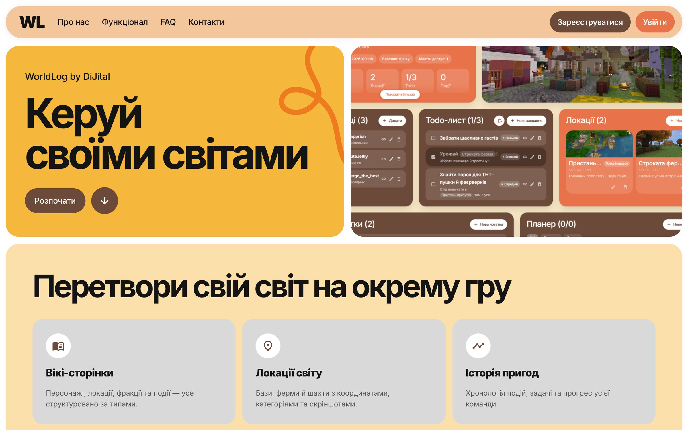
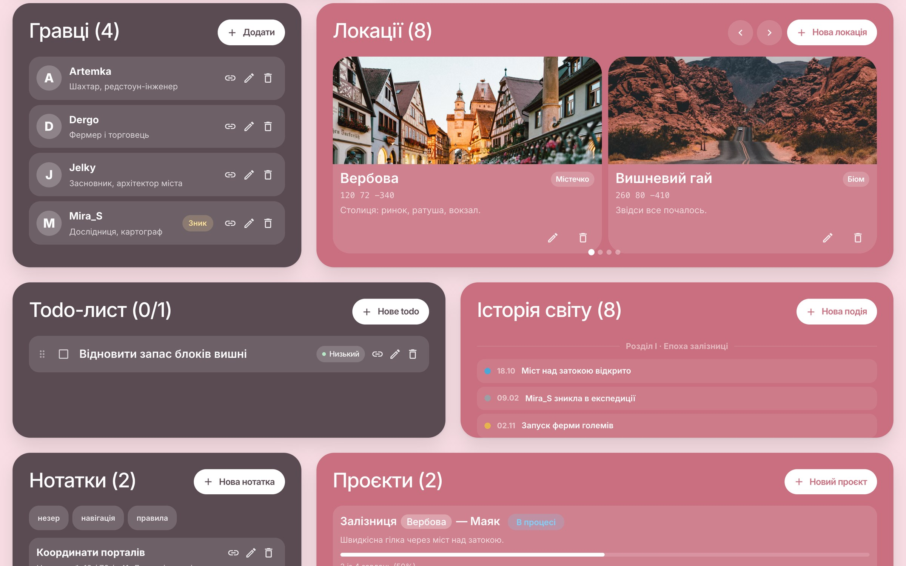
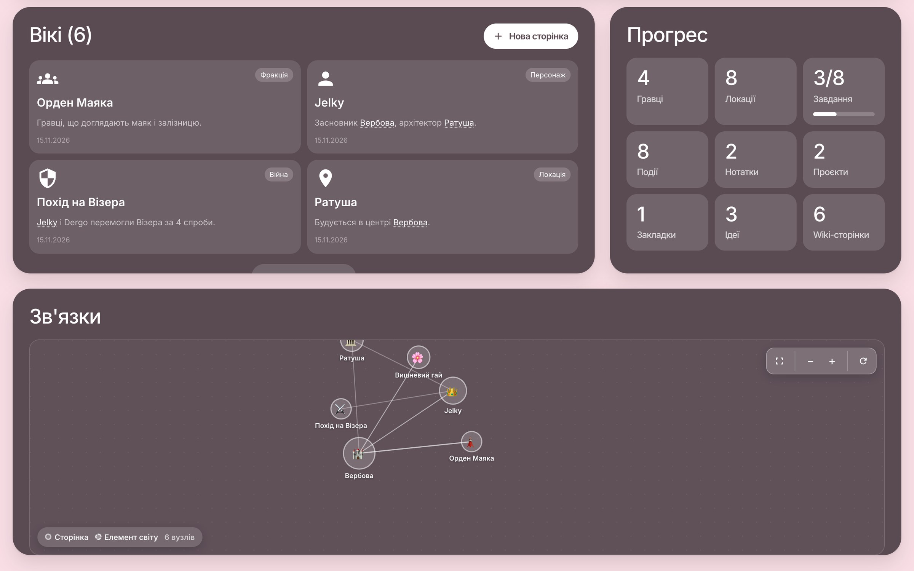
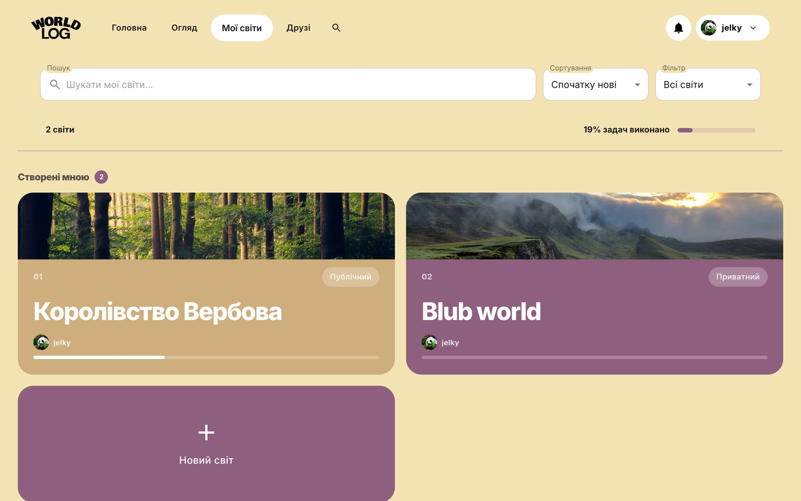

<div align="center">


**A passport for your Minecraft world.**

A shared journal for a game world: players, locations with coordinates, tasks and projects, a timeline split into eras, a linked wiki and a relationship graph — so your team remembers what happened, where and when.

🚧 In active development · 🇺🇦 Ukrainian UI · Open source (MIT) · by team **DiJital**

[Case study](https://ttjelky.github.io/portfolio/en/work/worldlog/)




</div>

## Why

Big servers live for months, and a world's history gets lost in chats and screenshots. WorldLog keeps everything in one place.

## Features

**Your world on one page** — cards you can rearrange and hide:

- **Players** with roles and status (alive / dead / missing)
- **Locations** with X/Y/Z coordinates, categories and screenshots
- **To-dos and projects** with priorities, deadlines and progress
- **Planner** for today / tomorrow
- **History** — events with date, in-game day, coordinates and participants, grouped into **eras** and shown as a timeline
- **Notes, bookmarks and ideas** with voting (open / accepted / rejected)
- **Wiki** — pages for characters, factions, kingdoms, wars and items, with infoboxes and `[[links]]` between pages
- **Relationship graph** — an interactive D3 graph of how everything in the world is connected
- **Progress** — a summary of everything recorded so far

**Look and feel**

- 9 visual themes based on Minecraft biomes (Cherry Grove, Amethyst, Pale Garden, Warm Ocean…)

**Community**

- Public and private worlds, world search, access requests
- Members with roles: owner, editor, viewer
- Friends, public profiles and notifications

## Screenshots

| A world | Wiki, progress and graph |
|:-:|:-:|
|  |  |



## Tech stack

| Layer | Technology |
|---|---|
| Backend | Python 3.12, Django 6, Django REST Framework, SimpleJWT, django-filter, Pillow |
| Frontend | React 19, React Router 7, MUI 6, TanStack Query, Axios, D3, Vite |
| Database | PostgreSQL in production, SQLite locally |
| Images | Cloudinary or any S3-compatible storage (optional, via `CLOUDINARY_URL`) |
| Deploy | Render (API + Postgres), Vercel / Netlify (frontend), Docker |

## Getting started

Requirements: Python 3.12+, Node.js 20+.

### Backend

```bash
cd backend
python -m venv .venv
source .venv/bin/activate        # Windows: .venv\Scripts\activate
pip install -r requirements.txt
python manage.py migrate
python manage.py runserver       # API: http://localhost:8000/api/
```

### Frontend

```bash
cd frontend
npm install
npm run dev                      # http://localhost:5173 — Vite proxies /api to :8000
```

### Docker (backend + Postgres)

```bash
docker compose up --build
```

### Tests

```bash
cd backend && python manage.py test
cd frontend && npm test
```

## Deployment

- **Backend + PostgreSQL** — [Render](https://render.com) with `render.yaml` or the Dockerfile in `backend/`. Required variables: `DJANGO_SECRET_KEY`, `DATABASE_URL`, `DJANGO_ALLOWED_HOSTS`, `CORS_ALLOW_ALL_ORIGINS` (or a list in `CORS_ALLOWED_ORIGINS`).
- **Frontend** — [Vercel](https://vercel.com) or [Netlify](https://netlify.com) from `frontend/` (`npm run build`). Set `VITE_API_URL` to your API URL.
- **Images** — free hosting file systems are ephemeral, so set `CLOUDINARY_URL` (or the separate Cloudinary variables).

Examples: `backend/.env.example` and `frontend/.env.example`.

## API overview

Auth: `Authorization: Bearer <access>`.

| Method | Path | Description |
| --- | --- | --- |
| POST | `/api/auth/register/` | Register |
| POST | `/api/auth/token/` · `/api/auth/token/refresh/` | Get / refresh a JWT |
| GET/POST | `/api/worlds/` | List / create worlds |
| GET/PATCH/DELETE | `/api/worlds/:id/` | World details |
| GET | `/api/worlds/search/` | Search public worlds |
| CRUD | `/api/worlds/:id/{players,locations,todos,history,epochs,notes,projects,bookmarks,ideas,wiki,relationships}/` | World sections |
| POST | `/api/worlds/:id/locations/:loc/screenshots/` | Upload a location screenshot |
| CRUD | `/api/worlds/:id/memberships/` · `/api/worlds/:id/access-requests/` | Members and access requests |
| GET/POST | `/api/friends/` and `/api/friends/send/` | Friends |
| GET | `/api/notifications/` | Notifications |

## Project structure

```
worldlog/
├── backend/
│   ├── api/          # models, serializers, views, permissions
│   └── config/       # Django settings
├── frontend/
│   └── src/
│       ├── features/ # landing, auth, dashboard, worlds, world sections, friends, search, profile
│       └── shared/   # components, notifications, undo, styles
├── docker-compose.yml
├── render.yaml
└── LICENSE
```

## Team

**DiJital**

- **[Oleksii Bezklynskyi](https://github.com/ttjelky)** — idea, ~90% of the code, design, logo and visual identity
- **Serhii Deineha** ([@dergo0-0](https://github.com/dergo0-0))

Questions and ideas — via GitHub Issues.

## License

MIT — see [LICENSE](LICENSE).
